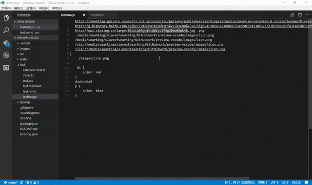

# preview-vscode

A Previewer of Markdown, ReStructured Text, HTML, Jade, Pug, Mermaid files, Image's URI for Visual Studio Code

## README

An extension to preview Markdown, ReStructured Text, HTML, Jade, Pug or Mermaid files or Image's URI while editing them in VSCode

The extension can be activated in two ways

* Toggle Preview
  * Linux & Windows: `ctrl+shift+v`
  * MAC:`cmd+shift+v` or `ctrl+shift+v`
* Open|Close Preview to the Side
  * Linux & Windows: `ctrl+k v`
  * MAC:`cmd+k v` or `ctrl+k v`

Just press the same key when you want to go back to the original view.

## DETAIL

* If file type is Markdown, ReStructured Text, HTML, Jade, Pug or Mermaid
  * Just do as the operation as mentioned.
* If file type is other
  * Just click on a  
    * image URI (/http[s]{0,1}:\/\/|file:\/\/|\s[\.]{0,2}\//).
      * for example: http://, https://, file://, /, ./
    * css properities ({})
      * for example: {color: blue}
    * others as Markdown, ReStructured Text, HTML, Jade or Mermaid
    * Just do as the operation as mentioned and a showQuickPick will pop up to show choices.
* With `markdown.rst.esbonio.enabled` (off by default), reStructuredText files of a Sphinx project (a `conf.py` in the directory of the file or above, up to the workspace folder) are previewed by [Esbonio](https://marketplace.visualstudio.com/items?itemName=swyddfa.esbonio) when it is installed and its language server is running, as it renders with Sphinx. Other files, or without Esbonio, are previewed by this extension.
* Scripts in the previewed page, e.g. `<script>` of an HTML file, only run when the preview security is `Disable` (`Markdown: Change Preview Security Settings`), do it only for files you trust.
* Fenced code blocks of languages the built-in Markdown grammar doesn't know, e.g. ```` ```desktop ````, are highlighted in the editor with the grammars of the installed extensions (e.g. [Linux Desktop File support](https://marketplace.visualstudio.com/items?itemName=nico-castell.linux-desktop-file)) (`markdown.fenced-languages.enabled`). The grammar is generated when the extensions change and takes effect after reloading the window, not in VS Code for the Web. How well it works depends on the grammar of the language, e.g. one anchored at the line start (`^Name`) doesn't highlight indented code blocks.
    * 

## Contributing

* Develop and debug

    ```bash
    npm install
    npm run watch   # or `npm run compile` once, then press F5 in VS Code to launch the Extension Development Host
    npm run lint
    npm test                             # npm run test:unit, builds, then compares the samples in test-workspace with test/snapshots
    UPDATE_SNAPSHOTS=1 npm run test:unit # rewrites the snapshots after an intended change, review them in git diff
    ```

* Layout
  * `src/extension`: extension entry, contributes the markdown-it plugins to the built-in Markdown preview.
  * `src/renders`: markdown-it plugins, simple third-party plugins are configured in `src/renders/markdown-it-plugins.ts`.
  * `src/preview`: script loaded into the preview by `markdown.previewScripts`, renders Mermaid diagrams and the code copy button.
  * `src/notebook`: notebook renderer, extends `vscode.markdown-it-renderer`.
  * `syntaxes/markdown.tmLanguage.json`: VS Code's builtin Markdown grammar, patched so indented lines are highlighted as Markdown rather than code, and front matter in Markdown code blocks is highlighted as YAML.
  * `syntaxes/shell.tmLanguage.json`: VS Code's builtin shell grammar, used by shell code blocks in Markdown and patched so commands in list items are highlighted too.
  * Regenerate both with `npm run update-syntaxes [VS Code extensions directory]` (defaults to the latest `microsoft/vscode` main, honors `HTTPS_PROXY`, requires Node.js 24.5+), which also syncs the grammar contribution in `package.json`.
  * `package.nls*.json`: translations of the `package.json` contributions, `l10n/bundle.l10n.*.json`: translations of the `vscode.l10n.t` strings, keyed by the English string.
  * `test-workspace`: sample files to preview.
  * `test`: renders the samples tracked by git like the preview with the bundled extension and a mocked `vscode` (`test/extension.cjs`), and tokenizes the Markdown samples with the grammars, compared with the snapshots in `test/snapshots`.

* Notes
  * The preview only runs scripts carrying its CSP nonce, so inline `<script>` in rendered Markdown never runs with the default security settings, use `src/preview` instead. With the preview security `Disable`, `src/preview/scripts.ts` runs them, as VS Code inserts the content with `DOMParser`, which never runs scripts.
  * reStructuredText is rendered by `rst-compiler` (`src/renders/markdown-it-rst.ts`), directives, roles and references it can't render fall back to their source or text, a document it still can't compile is shown as the error and its source. `shiki` is aliased to `src/renders/util/shiki-stub.ts` in `webpack.config.js`, `rst-compiler` only reads its language list.
  * Every setting in `contributes.configuration` reloads the markdown-it plugins when it changes.
  * `@types/vscode` must not be newer than `engines.vscode`.

* Release: bump `version` in `package.json` and the `[Unreleased]` section of `CHANGELOG.md`, commit, then push the tag `v<version>`. `.github/workflows/release.yml` publishes it to the VS Code Marketplace and Open VSX and creates the GitHub release with the vsix, it needs the secrets `VSCE_PAT` and `OVSX_PAT` of the `release` environment. Run it manually to publish a pre-release. `.github/workflows/ci.yml` lints and packages every push and pull request.

* Package and publish manually to the [VS Code Marketplace](https://code.visualstudio.com/api/working-with-extensions/publishing-extension) and [Open VSX](https://github.com/eclipse/openvsx/wiki/Publishing-Extensions) (used by VSCodium, Cursor, Gitpod, ...)

    ```bash
    npm run dist           # pre-release package, `npm run dist:stable` for stable
    npm run vscode:publish # pre-release publish, `npm run vscode:publish:stable` for stable, login by `npx vsce login searKing`
    npm run ovsx:publish   # pre-release publish, `npm run ovsx:publish:stable` for stable, login by `npx ovsx login searKing` or pass `-- -p <token>`
    ```

## Thanks to

* [html-preview-vscode](https://github.com/tht13/html-preview-vscode.git).

* [vscode-imagepreview](https://github.com/buzzfrog/vscode-imagepreview.git).

* [vscode-mermaid-preview](https://github.com/vstirbu/vscode-mermaid-preview.git).